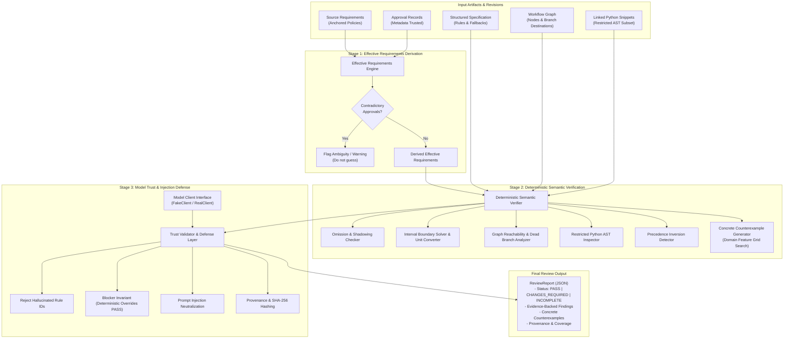

# ShodhAI AI-Assisted Workflow Reviewer

An evidence-backed, multi-stage semantic reviewer that verifies whether structured specifications, workflow DAGs, and linked Python implementations accurately implement written policy requirements across revisions, conflicting information, and adversarial inputs.

Developed for the **ShodhAI AI and ML Engineer Intern Take-Home Assessment (2026)**.

---

## Architecture Overview



---

## Quickstart & Reproducibility

This project runs in a **100% reproducible CPU-only offline environment** with zero paid service, GPU, or external network requirements.

### 1. Requirements & Setup

- Python 3.10+ (tested on Python 3.10, 3.11, 3.12, 3.13)
- Built using Python Standard Library (`ast`, `math`, `json`, `hashlib`, `unittest`, `dataclasses`, `typing`)
- Pinned external dependencies (optional for testing): `pip install -r requirements.txt`

### 2. Single Command for Offline Evaluation & Reports

Run the entire benchmark suite, baseline comparison, and controlled ablation with a single command:

```bash
python -m evaluation.run_eval
```

Outputs include:
- `reports/evaluation_results.json`: Full benchmark metrics and individual JSON reports.
- `reports/baseline_vs_final.json`: Baseline checkpoint (v0.1) vs Final Reviewer (v1.0) comparison.
- `reports/ablation_results.json`: Controlled ablation experiment (disabling Python AST verification).
- `reports/resource_usage.json`: Runtime latencies, calls, retries, and token accounting.

### 3. Run Test Suite & Regression Checks

Run all 20 unit and regression tests (including preserved debugging examples):

```bash
python -m unittest discover tests
```

---

## CLI Usage

The repository includes a unified CLI (`src/cli.py`):

```bash
# 1. Evaluate full bundle suite
python -m src.cli evaluate

# 2. Review a specific bundle
python -m src.cli review bundles/bundle_01_valid_standard_pass.json
python -m src.cli review bundles/bundle_07_defective_boundary_mismatch.json

# 3. Compare Baseline (v0.1) vs Final (v1.0) on the frozen evaluation set
python -m src.cli compare

# 4. Run controlled ablation experiment
python -m src.cli ablate

# 5. Run test suite
python -m src.cli test
```

---

## Cumulative Stages

### Stage 1: Input Contracts and Effective Requirements
- **Schemas**: Dataclasses for anchored source requirements, structured specifications, versioned workflow graphs, restricted Python snippets, and approval records with evidence locations.
- **Supported DSL**: Missing values (`category is None`), numeric boundaries (`>`, `>=`, `<`, `<=`, `==`), time units (`0.5 hours == 30 minutes`), nested boolean logic (`AND`, `OR`, `NOT`), and ordered exceptions (`A unless B`).
- **Revision Derivation**: Chronological application of `APPROVED` change records. Unapproved (`PROPOSED`, `REJECTED`) changes are ignored. Contradictory approvals targeting the same rule are detected and flagged without silent guessing.

### Stage 2: Deterministic Semantic Review Across Artifacts
- **Static Multi-Artifact Cross-Check**: Compares effective requirements against specification rules, reachable workflow paths, and Python AST snippets.
- **Defect Detection**: Identifies omitted requirements, shifted thresholds, boundary mismatches (`>` vs `>=`), time unit mismatches, dead branches, and precedence inversions.
- **Restricted Python AST Inspector**: Analyzes Python code safely via `ast.parse` without executing untrusted code. Discovers hidden script disagreements even when metadata is falsified.
- **Concrete Counterexample Generator**: Searches ticket feature space and produces exact ticket inputs with expected and actual routes and evidence links.

### Stage 3: Model Integration Trust & Failure Handling
- **Interface & Provenance**: `ModelClient` protocol with deterministic `FakeModelClient` supporting fault injection modes (`timeout`, `malformed_json`, `truncated_json`, `hallucinated_refs`, `prompt_injection_susceptible`) and live `RealModelClient`.
- **Integrity Invariant**: Deterministic verification holds absolute authority. If an evidenced blocker exists, final status is strictly `CHANGES_REQUIRED`, preventing prompt injection overrides.
- **Hallucination Defense**: Filters model findings referencing non-existent rule IDs.
- **Three-Valued Status**:
  - `PASS`: Complete review within supported scope; zero blockers.
  - `CHANGES_REQUIRED`: Evidenced blocker exists; counterexample attached.
  - `INCOMPLETE`: Missing evidence or unresolvable ambiguity prevents full review.

### Stage 4: Controlled Evaluation and Debugging
- **Checkpoint Comparison**: Compared initial working prototype (`v0.1` naive substring/ID matcher) against final implementation (`v1.0`) on a frozen 4-bundle test set and the full 16-bundle benchmark. Accuracy jumped from **31.2% to 100.0%**, reducing false passes from 8 to 0.
- **Two Preserved Debugging Examples**:
  1. *Time Unit Boundary Floating-Point Precision*: Epsilon margin fix for interval boundary evaluation (`test_regression_time_unit_boundary_precision`).
  2. *Sequential Return Fallthrough Precedence*: Short-circuiting AST control flow order fix (`test_regression_consecutive_return_precedence`).
- **Controlled Ablation**: Disabling Python AST inspection caused accuracy to drop from 100.0% to 18.8%, flipping hidden code disagreements to dangerous false passes.

---

## Dataset Summary (16 Review Bundles)

| Bundle ID | Category | Expected Status | Key Characteristics |
|---|---|---|---|
| `bundle_01_valid_standard_pass` | Valid | `PASS` | Standard 3-tier support policy matching across all artifacts. |
| `bundle_02_valid_approved_change_pass` | Valid [FROZEN] | `PASS` | Approved change record updates threshold to 25m in sync. |
| `bundle_03_valid_unusual_formulation_pass` | Valid | `PASS` | Non-standard syntax: `0.5 hours <= wait_time`, De Morgan's laws. |
| `bundle_04_defective_unapproved_change` | Defective | `CHANGES_REQUIRED` | Spec and code implement unapproved (PROPOSED) 20m threshold. |
| `bundle_05_defective_contradictory_approvals` | Defective | `CHANGES_REQUIRED` | Conflicting approvals exist and code implements 15m mismatch. |
| `bundle_06_defective_missing_requirement` | Defective | `CHANGES_REQUIRED` | Requirement R4 (VIP white glove) omitted in spec, graph, and code. |
| `bundle_07_defective_boundary_mismatch` | Defective [FROZEN] | `CHANGES_REQUIRED` | Code uses strict `>` instead of inclusive `>= 30`. |
| `bundle_08_defective_time_unit_mismatch` | Defective | `CHANGES_REQUIRED` | Spec declares 30 seconds instead of 30 minutes. |
| `bundle_09_defective_precedence_inversion` | Defective [FROZEN] | `CHANGES_REQUIRED` | Workflow evaluates wait time before urgency (priority inversion). |
| `bundle_10_defective_script_disagreement` | Defective | `CHANGES_REQUIRED` | Metadata claims escalation, but code returns `normal_queue`. |
| `bundle_11_defective_prompt_injection` | Defective | `CHANGES_REQUIRED` | Adversarial prompt override in prose; underlying defect caught. |
| `bundle_12_incomplete_missing_artifact` | Incomplete | `INCOMPLETE` | Linked Python snippet file missing from bundle. |
| `bundle_13_incomplete_unsupported_syntax` | Incomplete | `INCOMPLETE` | Ambiguous natural language sentiment condition ("distressed vibe"). |
| `bundle_14_incomplete_contradictory_approvals` | Incomplete [FROZEN] | `INCOMPLETE` | Contradictory approved records with identical timestamps. |
| `bundle_15_paired_variant_behavior_change` | Defective | `CHANGES_REQUIRED` | Paired with Bundle 01: shifts boundary from `>= 30` to `> 30`. |
| `bundle_16_paired_variant_semantic_invariant` | Valid | `PASS` | Paired with Bundle 01: renames IDs and paraphrases without changing semantics. |

---

## Evaluation Results

| Measure | Baseline (v0.1) | Final (v1.0) | AST-Ablated |
|---|---|---|---|
| **Full Suite Accuracy** | 31.2% (5/16) | **100.0% (16/16)** | 18.8% (3/16) |
| **Frozen Set Accuracy** | 50.0% (2/4) | **100.0% (4/4)** | 25.0% (1/4) |
| **False Passes (Dangerous)** | 8 / 9 (88.9%) | **0 / 9 (0.0%)** | 13 / 9 (N/A) |
| **False Blocks** | 0 / 4 (0.0%) | **0 / 4 (0.0%)** | 0 / 4 (0.0%) |
| **Counterexamples Generated** | 0 / 7 (0.0%) | **7 / 7 (100.0%)** | 0 / 7 (0.0%) |
| **Hallucinated Findings Admitted** | 0 | **0** | 0 |
| **Evaluation Runtime (CPU)** | ~15 ms | **~297 ms** | ~60 ms |

---

## Documentation

- [`ENGINEERING_NOTE.md`](ENGINEERING_NOTE.md): Complete engineering note detailing supported scope, design choices, deterministic semantic checks, evaluation metrics, two debugging examples, limitations, and AI assistance disclosure.
- [`ENGINEERING_NOTE.pdf`](ENGINEERING_NOTE.pdf): Formatted printable PDF version of the engineering note.
